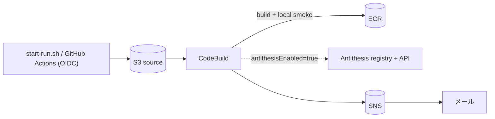

# antithesis-test

AWS環境下で [Antithesis](https://antithesis.com/) を検証するリソースです。
AWS CDK（TypeScript）で書いたIaCを [cdkd](https://cdkd.dev)（`@cdkd/cli`）でデプロイします。
進め方は [AI-DLC](https://github.com/awslabs/aidlc-workflows) に沿っており、設計の記録は
[`aidlc/spaces/default/intents/261112-antithesis-aws-verification/`](aidlc/spaces/default/intents/261112-antithesis-aws-verification/aidlc-state.md) にあります。

## できること

Antithesisの評価を、次の3段階で同じパイプラインに流せます。

| 段階 | 内容 | 必要なもの |
| --- | --- | --- |
| Step 1 無料の事前検証 | Docker Compose、SDKのアサーション、Test Composerのコマンドを AWS CodeBuild 上で実行し、SDKの出力を判定する | AWSアカウント |
| Step 2 バグを仕込む | `BANK_BUG_MODE=non_atomic_transfer` で送金処理を非アトミックにし、「検出される」ことを確認する | 同上 |
| Step 3 Teams / PoC | イメージを Antithesis のレジストリへ push し、`launch_experiment` APIでテストを起動する | Antithesisのテナント、APIキー、レジストリキー |



## 構成

```
sut/                     Antithesis に渡す「テストの形」
  bank/                  検証対象: 送金台帳サービス（プロパティ: 総額は不変）
  workload/              Antithesis SDK + Test Composer (/opt/antithesis/test/v1/bank/)
  config/                docker-compose.yaml と config イメージ
  tools/check_assertions.py  SDK の出力（JSONL）を判定
scripts/
  local-smoke.sh         無料の事前検証（手元でも CodeBuild でも動く）
  start-run.sh           コミット済みソースを S3 へ upload し CodeBuild を起動
infra/                   AWS CDK アプリ（cdkd でデプロイ）
.github/workflows/       CI（tsc / jest / cdkd synth + cdk-nag / smoke）と手動起動
aidlc/                   AI-DLC の成果物（要件・設計・テスト結果・runbook）
```

## クイックスタート

手元で試す場合（Dockerがあれば、AWSもAntithesisも不要です）:

```bash
./scripts/local-smoke.sh
```

```bash
BANK_BUG_MODE=non_atomic_transfer ./scripts/local-smoke.sh
```

1つ目は `outcome=pass` になり、2つ目は保存則の違反を検出して `outcome=fail expected=fail` になります。

AWSへのデプロイ:

```bash
cd infra && npm ci --ignore-scripts && npx cdkd bootstrap
```

```bash
npx cdkd deploy -O cdk-outputs.json -c notificationEmail=you@example.com
```

```bash
cd .. && BANK_BUG_MODE=non_atomic_transfer WAIT=1 ./scripts/start-run.sh
```

Antithesisへの切り替え、片付けの手順は [runbook](aidlc/spaces/default/intents/261112-antithesis-aws-verification/operation/deployment-execution/runbook.md) を参照してください。

## セキュリティ

- 認証情報は Secrets Manager（KMS）にだけ置きます。CodeBuild の環境変数には置かず、信頼できないビルド処理が終わった後の `post_build` でのみ取得します。Antithesis が無効な間は、読み取り権限そのものを付与しません。
- buildspec は `infra/` 側に固定しています。アップロードされたソースから、秘密の扱いを変えることはできません。
- `start-run.sh` は `git archive` でコミット済みのファイルだけを送ります。手元の鍵ファイルを誤って送ることはありません。
- S3、ECR、ログ、SNS、シークレット、CodeBuild は KMS の CMK（ローテーション有効）で暗号化しています。S3 はパブリックアクセスを全てブロックし、TLS を強制します。ECR はプッシュ時スキャンを有効にし、タグを不変にしています。
- GitHub からの起動は OIDC で行います。リポジトリとブランチを固定し、長期キーは使いません。Actions はコミットSHAで、pip はハッシュで固定しています。
- synth のたびに cdk-nag（AwsSolutions）が走ります。指摘を承認する場合は、すべて理由を付けています。
- 残存リスク（特権モードの CodeBuild など）と、その対策は [security-design.md](aidlc/spaces/default/intents/261112-antithesis-aws-verification/construction/aws-pipeline/nfr-design/security-design.md) にまとめています。

> cdkd は dev/test 向けのツールです。本番に移すときは `cdkd export` で CloudFormation 管理に切り替えられます。
