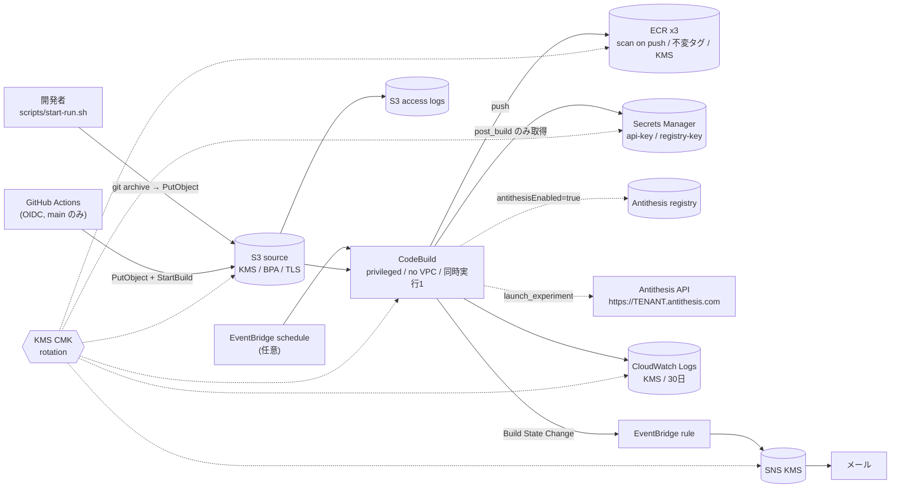

# U2 aws-pipeline — Infrastructure Design

## リソース一覧（既定構成 18 リソース）
| リソース | 主な設定 |
| --- | --- |
| KMS Key + Alias | ローテーション有効、Logs / EventBridge 用のキーポリシー（アカウント条件付き） |
| S3 AccessLogsBucket | SSE-S3（ログ配信の制約）、BPA、TLS 強制、90 日で失効 |
| S3 SourceBucket | SSE-KMS + Bucket Key、BPA、TLS1.2+、バージョニング、アクセスログ |
| ECR x3 | `<env>/antithesis-{bank,workload,config}`、scan on push、IMMUTABLE、KMS、最新 20 件保持 |
| Secrets Manager x2 | `antithesis-<env>/api-key`, `/registry-key`。作成時はランダムなプレースホルダ |
| CodeBuild Project | STANDARD_7_0 / MEDIUM / privileged、buildspec は infra 側に固定、60 分 |
| LogGroup | KMS、30 日 |
| SNS Topic + Policy | KMS、TLS 強制 |
| EventBridge Rule | SUCCEEDED / FAILED / STOPPED を通知 |
| （任意）EventBridge schedule | `scheduleExpression` |
| （任意）OIDC Provider + Role | `githubRepository` / `githubBranch`、既存 Provider の再利用可 |

## cdkd 適合性
- 全リソース型が cdkd の SDK プロバイダ対応（OIDC Provider のみ Cloud Control フォールバック）
- カスタムリソース・Lambda・アセット（Docker/ファイル）なし。`autoDeleteObjects` も不使用
- `generateBootstrapVersionRule: false`（cdkd は CDK bootstrap を使わない）
- フィーチャーフラグはコード（`lib/feature-flags.ts`）で適用し、cdkd / テストで同一テンプレートを生成

## 設定（CDK context）
| key | 既定 | 説明 |
| --- | --- | --- |
| `envName` | `dev` | 名前の接頭辞 |
| `antithesisEnabled` | `false` | true で Antithesis へ push / 起動、シークレット読み取り権限を付与 |
| `antithesisTenant` | `""` | `<tenant>.antithesis.com` |
| `antithesisRegistry` | `""` | Antithesis 発行のレジストリパス |
| `antithesisWebhook` | `basic_test` | `launch_experiment/<webhook>` |
| `antithesisDurationMinutes` | `30` | 1〜1440 |
| `bankBugMode` | `none` | 既定のバグモード（起動時に上書き可） |
| `notificationEmail` | `""` | 通知先 |
| `scheduleExpression` | `""` | `cron(...)` / `rate(...)` |
| `githubRepository` / `githubBranch` / `githubOidcProviderArn` | `""` / `main` / `""` | GitHub OIDC |
